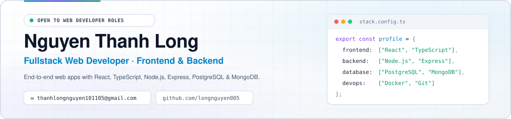

  <picture>
    <source media="(prefers-color-scheme: dark)" srcset="assets/banner-dark.svg" />
    <source media="(prefers-color-scheme: light)" srcset="assets/banner-light.svg" />
    
  </picture>

   

  
  
  
  

---

### About Me

I am a **Fullstack Web Developer** focused on building reliable, maintainable web products end-to-end — from responsive **React & TypeScript** workspaces to structured **Node.js, Express, PostgreSQL, and MongoDB** backends.

- **Product & Systems Focus:** Experienced in designing human-in-the-loop workflows, multi-stage worker pipelines, JWT/OAuth session security, rate-limited APIs, and real-time Server-Sent Events (SSE).
- **Engineering Discipline:** Strong emphasis on clear API contracts, database schema migrations, reproducible Docker environments, and automated testing.
- **Contact:** Reach me directly at **[thanhlongnguyen101105@gmail.com](mailto:thanhlongnguyen101105@gmail.com)**.

---

### Core Tech Stack

| Layer | Technologies |
| :--- | :--- |
| **Frontend** |       |
| **Backend & Database** |      |
| **DevOps & Tooling** |      |

---

### Featured Projects

<table>
  <tr>
    <td width="50%" valign="top">
      <h3>Planora — AI Workflow Automation Platform</h3>
      

        <code>React 19</code> · <code>TypeScript</code> · <code>Tailwind 4</code> · <code>Zustand</code> · <code>Node.js</code> · <code>Express 5</code> · <code>PostgreSQL 16</code> · <code>Docker</code>
      

      <ul>
        <li>Chat-driven multi-step automation across GitHub, Trello, Slack, Jira, Notion, and Google Workspace with a mandatory SHA-256 <code>plan_hash</code> human approval gate before any external write.</li>
        <li>Streams live step execution via Server-Sent Events (SSE), isolates workspace OAuth credentials with AES-256-GCM, and runs Vitest + Playwright E2E suites in CI.</li>
      </ul>
      

        <a href="https://planora-ivory-tau.vercel.app"><strong>Live Demo</strong></a> ·
        <a href="https://planora-ivory-tau.vercel.app/?view=sandbox"><strong>Interactive Sandbox</strong></a> ·
        <a href="https://github.com/longnguyen005/planora"><strong>Frontend Repo</strong></a> ·
        <a href="https://github.com/VinhDat267/ATI_Project"><strong>Fullstack Monorepo</strong></a>
      

    </td>
    <td width="50%" valign="top">
      <h3>DeckAI — AI Slide Generator</h3>
      

        <code>React 19</code> · <code>JavaScript</code> · <code>Node.js</code> · <code>Express</code> · <code>MongoDB</code> · <code>Mongoose</code> · <code>JWT</code> · <code>Docker</code>
      

      <ul>
        <li>Stage-gated presentation studio (Prompt &rarr; Outline &rarr; 5-Layout Canvas &rarr; 4 Brand Themes &rarr; Presenter View) with SlideVersion restore, PDF handouts, and themed <code>.pptx</code> export.</li>
        <li>Engineered with hybrid Instant Demo (server seeding + &lt;3.5s offline sandbox fallback), multi-key Gemini rotation/fallback chains, Zod validation, and GitHub Actions CI.</li>
      </ul>
      

        <a href="https://ai-slide-generator-omega.vercel.app"><strong>Live Demo</strong></a> ·
        <a href="https://github.com/longnguyen005/AI-SLIDE-GENERATOR"><strong>Source Code</strong></a>
      

    </td>
  </tr>
  <tr>
    <td width="50%" valign="top">
      <h3>ResumeAI — ATS Resume Analyzer &amp; Job Fit Scoring</h3>
      

        <code>React 18</code> · <code>FastAPI</code> · <code>SQLAlchemy 2.0 Async</code> · <code>PostgreSQL 16</code> · <code>Alembic</code> · <code>Docker</code> · <code>n8n</code> · <code>OCR</code>
      

      <ul>
        <li>Fullstack ATS optimization platform featuring server-verified Keyword Gap Matrices, parser readability diagnostics, cached JD re-scoring, side-by-side 2-version CV comparison, and print-ready PDF reports.</li>
        <li>Engineered with Hybrid Instant Demo (24h ephemeral PostgreSQL seeding + &lt;3.5s browser sandbox fallback), <code>SELECT ... FOR UPDATE</code> row locking across <code>inline</code> &amp; <code>n8n</code> worker pipelines, and PostgreSQL 16 CI suites.</li>
      </ul>
      

        <a href="https://github.com/longnguyen005/SS2_Project_Resume-Analyzer-Job-Fit-Scoring"><strong>Source Code &amp; Architecture Docs</strong></a>
      

    </td>
    <td width="50%" valign="top">
      <h3>EatNow — Food Discovery &amp; FootBot</h3>
      

        <code>Next.js</code> · <code>React 19</code> · <code>TypeScript</code> · <code>Tailwind CSS</code> · <code>Supabase (PostgreSQL)</code> · <code>Google Maps API</code>
      

      <ul>
        <li>Fullstack restaurant discovery and ordering web app featuring interactive Google Maps browsing, real-time menu filtering, and cart checkout flows.</li>
        <li>Includes <code>FootBot</code>, an AI food-discovery assistant powered by Gemini function calling and atomic per-user PostgreSQL RPC rate limiting.</li>
      </ul>
      

        <a href="https://eat-now-app.vercel.app"><strong>Live Demo</strong></a> ·
        <a href="https://github.com/kurumi-hub/Eat_now_app"><strong>Team Repository</strong></a>
      

    </td>
  </tr>
</table>

---

### Additional Engineering Work

- **[Explainable_GEC_Long](https://github.com/longnguyen005/Explainable_GEC_Long)** (`Python` · `spaCy` · `Reproducible ML`): Audited grammatical error detection pipeline (`SVA`/`VFORM`/`NNUM`) built with strict train/dev/test isolation guards, SHA-256 artifact manifests, dependency-parse feature extraction, and automated unit tests.
